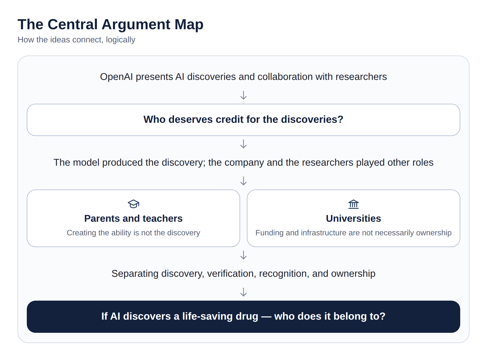
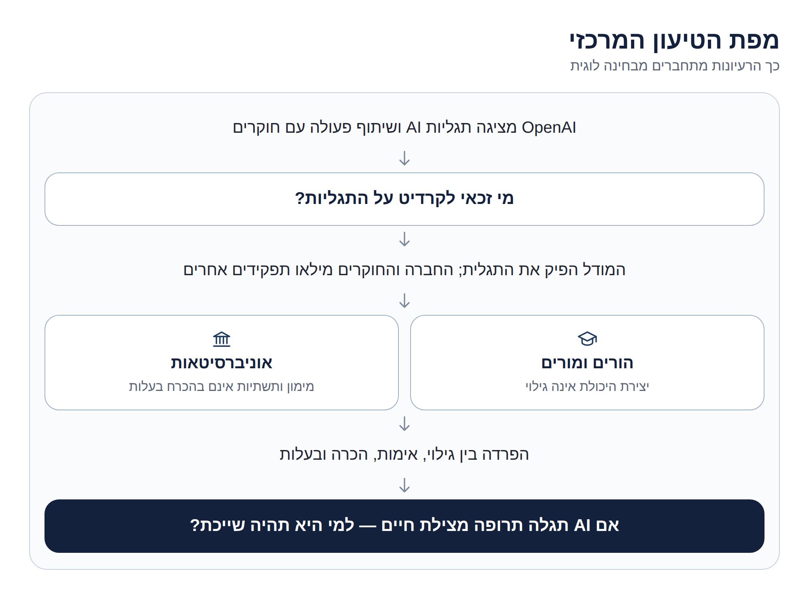
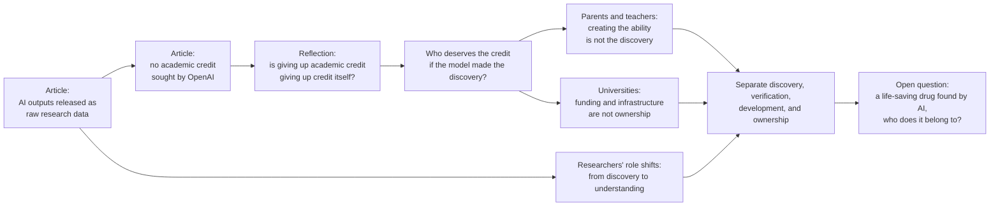

# Working with Academic Communities to Build Scientific Understanding — Personal Reflection

**When an AI system makes a scientific discovery, who deserves the credit, and who is entitled to own the result?**

A personal reflection on OpenAI's article *Working with Academic Communities to Build Scientific Understanding*, written for the **Human Interactions with AI** course at **HIT — Holon Institute of Technology**.

[**📝 Reflection (EN)**](docs/personal-reflection-en.pdf) · [**📝 Reflection (HE)**](docs/personal-reflection-he.pdf) · [**🧭 Key Takeaways**](docs/key-takeaways.md) · [**📖 The Article**](https://openai.com/index/building-scientific-understanding-with-academic-communities/)

---

## 🧭 Why This Topic Matters

OpenAI reports three results it says were produced by its internal models, and asks outside experts to help turn those model-written manuscripts into scientific understanding. Along the way, it states that it does not seek academic credit. This reflection takes that statement as its starting point and asks a broader question:

> If an AI system independently reaches a discovery that makes a life-saving drug possible, is the company that built and trained it entitled to a patent and the profits?

> This repository documents a student's personal reflection on a published article. It does not claim authorship of the article, original experiments, or new research findings, and it does not evaluate whether the mathematical, computational, or physical claims are correct. The views expressed are interpretation and opinion, not the conclusions of the article's authors.

## 📄 The Article at a Glance

OpenAI announces three results in mathematics, computer science, and physics, and describes the model-written manuscripts as **raw research data** that the academic community must turn into scientific understanding. It asks external experts to act as **shepherds** of groups that examine and explain each result, using a different release strategy for each.

| Field | OpenAI's claim | How it was released |
|-------|----------------|---------------------|
| **Mathematics** (harmonic analysis) | A proof of Sogge's 1991 local smoothing conjecture in every dimension, which OpenAI says also resolves the Kakeya and Stein restriction conjectures | AI output released publicly; researchers free to organize their own efforts; write-up and Lean proof on GitHub |
| **Computer science** (complexity theory) | A disproof of the Exponential Time Hypothesis (ETH), later verified in Lean | External group led by Impagliazzo, Paturi, and Williams; raw outputs public; OpenAI to fund a conference |
| **Physics** (quantum field theory) | A rigorous existence proof for certain interacting quantum field theories in four dimensions, including QCD and pure Yang–Mills theory | Group led by David Gross decides what to release, and chose to write up the work itself first |

A few other points the article makes:

- The collaborations follow four principles: **transparency** (no NDAs), **no academic credit** for OpenAI, **recognition** for the groups' understanding and write-ups, and **independence** (voluntary, unpaid participation).
- OpenAI says it **does not yet know** which of the three release strategies will be most useful, and invites feedback.
- It acknowledges a trade-off: choosing the first shepherds **shapes who gets involved first and creates an information asymmetry**.
- It pairs the announcement with funding: a contribution to a Simons Foundation initiative and a conference on the ETH result.
- These are OpenAI's claims, and they are being examined by outside groups. Please read the article itself for the exact claims and caveats.

## 🗺️ The Central Argument Map

How the reflection's ideas connect, logically:

<p align="center">
  
</p>

<details>
<summary><b>Hebrew version of the diagram</b></summary>

<p align="center">
  
</p>

</details>

## 🔗 From the Article to the Reflection



| Stage | Question the reflection raises |
|-------|--------------------------------|
| **Recognition** | Does giving up academic credit mean giving up credit itself, or only the formal kind? |
| **Who deserves it** | If neither the company nor the researchers conceived the idea, why should either receive credit for the discovery? |
| **The counterargument** | Credit is also a social mechanism for recognition and responsibility. Does it pass automatically to the company because an AI cannot hold either? |
| **Parents and teachers** | If those who taught a researcher do not get credit for the discovery, why should those who trained a model? |
| **Universities** | Does providing funding and infrastructure also grant ownership of the result? |
| **Researchers' role** | If AI does a growing share of discovery, does the weight move to examining, verifying, and understanding? |
| **Ownership** | Who should own a drug that an AI system discovers? |

The reflection's idea that the weight may shift from discovery to understanding **echoes the article's own framing** of model outputs as raw research data. Its questions about credit, universities, and ownership go beyond what the article discusses and are the author's own extension.

## 🔍 What the Reflection Explores

| Lens | Questions followed |
|------|--------------------|
| **Attribution** | Who made the discovery: the model, the company, or the researchers? Can credit go to a system that cannot hold it? |
| **Analogy** | Do parents, teachers, and lecturers of a human researcher offer a fair comparison for a company that trains a model? Where does it break down? |
| **Institutions** | Is the tension between those who fund research and those who benefit from it new, or is AI revealing an old one? |
| **Roles** | What happens to the researcher's role if discovery becomes less rare and understanding becomes the scarce work? |
| **Ownership** | Are credit, verification, development, and ownership separate questions with possibly separate answers? |

The reflection states its limits plainly: its argument applies to cases where the idea was truly produced by the model, and the article does not detail the full extent of human involvement.

## 📚 Materials

| Resource | Purpose |
|----------|---------|
| [📝 Reflection, English (PDF)](docs/personal-reflection-en.pdf) | The full reflection, formatted for reading and sharing |
| [📝 Reflection, Hebrew (PDF)](docs/personal-reflection-he.pdf) | The original Hebrew version |
| [📄 Markdown, English](docs/personal-reflection-en.md) · [Hebrew](docs/personal-reflection-he.md) | Same text, readable directly on GitHub |
| [🧭 Key takeaways](docs/key-takeaways.md) | A concise summary of the article's main points and the reflection's ideas |
| [🖼️ Argument map (HE)](assets/argument-map-he.png) · [EN](assets/argument-map-en.png) | The central argument as a diagram |

## 🎓 Academic Context

**Course:** Human Interactions with AI  
**Institution:** HIT — Holon Institute of Technology  
**Author of the reflection:** Shlomi Hazan

## 📖 The Article

**Working with academic communities to build scientific understanding**  
OpenAI, October 2026

- [🔗 Read the article (OpenAI)](https://openai.com/index/building-scientific-understanding-with-academic-communities/)

This repository is a student reflection on that article. The article itself is not redistributed here; please use the link above.

> Sometimes the most interesting question a discovery raises is not who made it, but who gets to understand it, and who gets to own it.

## 📂 Repository Structure

```
.
├── README.md
├── assets/                  # diagrams and visuals
│   ├── argument-map-en.png
│   ├── argument-map-he.png
│   └── social-preview.png
└── docs/
    ├── key-takeaways.md
    ├── personal-reflection-en.md
    ├── personal-reflection-en.pdf
    ├── personal-reflection-he.md
    └── personal-reflection-he.pdf
```
